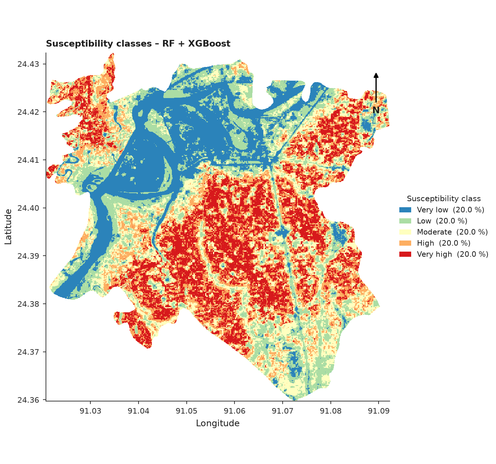
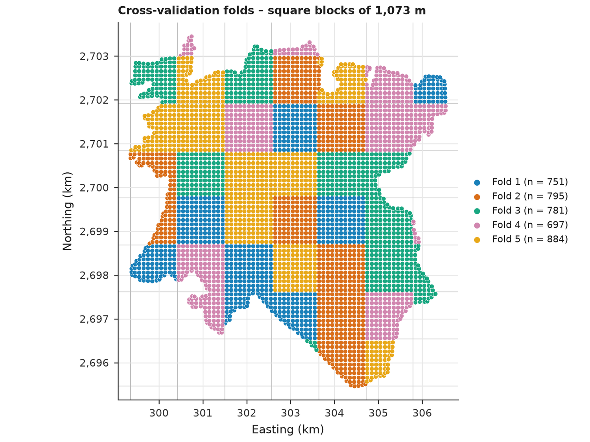
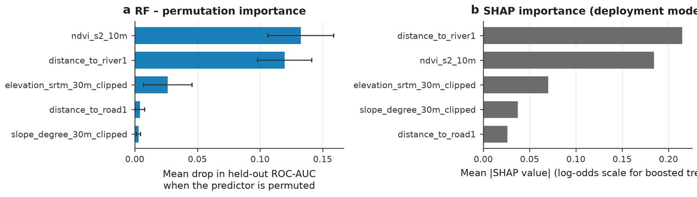
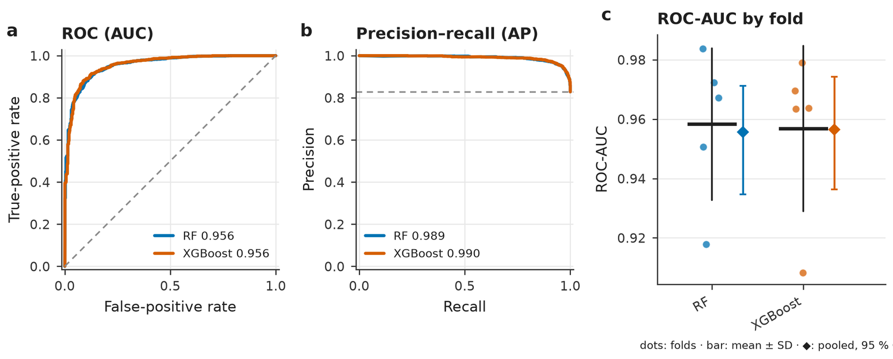
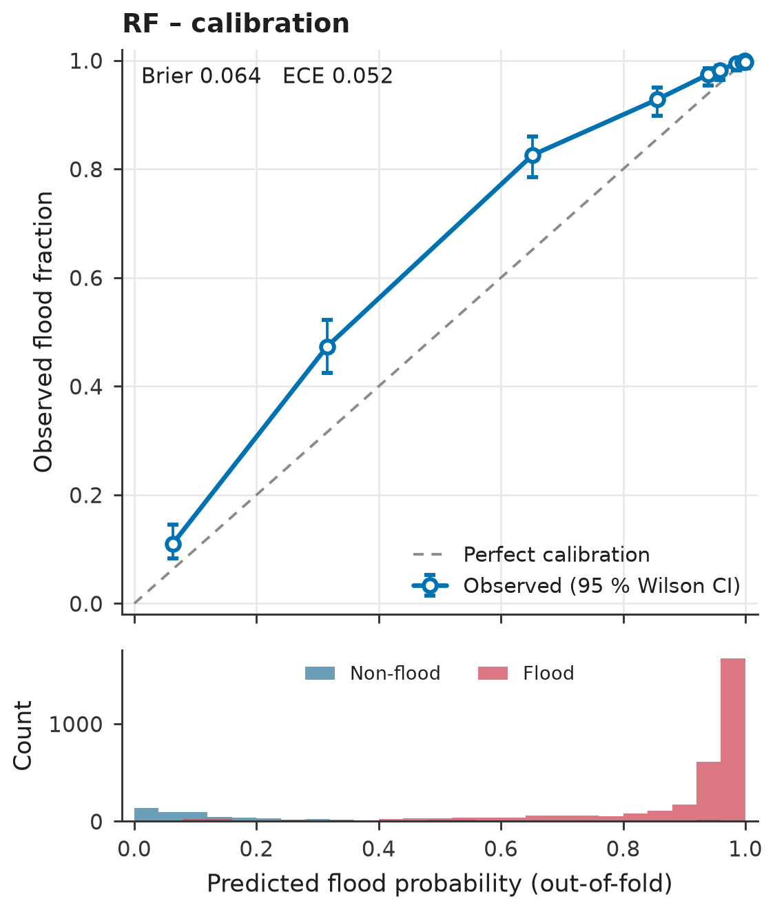

# FloodML-Geo

**Flood susceptibility mapping inside QGIS, checked with spatial cross-validation.**
Developed by **Md Mominul Islam**.


<p align="center">
  
</p>

FloodML-Geo adds a set of tools to the QGIS Processing Toolbox. You give it a flood record raster (0 = no flood, 1 = flood), predictor rasters (elevation, slope, NDVI, distance to river and so on) and either sample points or a grid of polygons. It builds the training table, checks it, trains the models, validates them honestly, and writes the susceptibility map.

**See the results:** open the [results gallery](https://YOUR-USERNAME.github.io/FloodML-Geo/) or browse the files in [`docs/reports`](docs/reports).

---

## What it does

| Tool | What it does |
|---|---|
| **01 Build the training table** | Reads the flood raster as the **target** and the other rasters as **predictors**. Points get the pixel value. Grid cells get the zonal mean, and the flooded share of the cell becomes the label. Rasters coarser than the cell are resampled virtually, so nothing is blurred. Optional exclusion of permanent water and tiny edge cells. Writes a CSV. |
| **02 Check the table** | Class balance, leakage hints, collinearity (VIF), missing values, spatial clustering (Moran's I), and a suggested block size. |
| **03 Train and validate** | Random Forest, XGBoost, LightGBM, HistGB, logistic regression. Preprocessing is fitted inside every fold. Spatial cross-validation (blocks, clusters, groups, buffer), nested tuning, bootstrap confidence intervals, permutation importance, SHAP, residual maps, and an HTML report. |
| **04 Map susceptibility** | Ensemble prediction, model spread, class map (quantile, equal, Jenks or custom), extrapolation raster, ready QGIS styles, preview PNG. |
| **05 Independent test** | Scores saved models on another area, event or year. Warns when the test records are the training records. |
| **06 Self-test** | Runs every tool on a built-in synthetic study area and compares the results with known answers. PASS or FAIL. |
| **07 Draw sample points** *(optional)* | Draws balanced flood and non-flood points from the flood raster if you have none. Not needed in the normal workflow. |

```
flood raster (0/1) = target ─┐
predictor rasters ───────────┼─► 01 table (CSV) ─► 02 check ─► 03 train + validate ─► 04 map ─► 05 independent test
points or grid polygons ─────┘                       06 self-test checks that all of this works
```

## Example results

These come from one run on 3,908 grid cells (100 m) with five predictors. Out-of-fold scores from nested spatial cross-validation, with 95 % cluster-bootstrap intervals:

| Model | ROC-AUC | PR-AUC | TSS | Brier | ECE |
|---|---|---|---|---|---|
| RF | 0.956 [0.935–0.971] | 0.989 [0.980–0.996] | 0.749 [0.697–0.801] | 0.064 | 0.052 |
| XGBoost | 0.956 [0.936–0.974] | 0.990 [0.980–0.997] | 0.771 [0.718–0.824] | 0.065 | 0.051 |

| Spatial folds | Predictor importance |
|---|---|
|  |  |

| ROC and precision-recall | Calibration |
|---|---|
|  |  |

More figures, all tables and the complete reports are in the [gallery](https://mominul58.github.io/FloodML-Geo/).

### Read this before you copy the numbers

This example shows what the reports look like. It is not a finished flood study.

- **Permanent water was not excluded** in this run, so the river channel is scored as non-flood and appears as the lowest class on the map. Tool 01 now has an exclusion raster for this. Use it for real work.
- **The independent test uses the training table.** The plugin detects this and marks the result *not valid* ([report](docs/reports/05_independent_test_report.html)). A real independent test needs another area, event or year.
- **Residuals are still spatially clustered** (Moran's I about 0.3), so some spatial structure is missing from the predictors.
- **Flood is 83 % of the records**, so PR-AUC looks high by default. Judge the models with TSS and the calibration plot as well.
- Quantile classes put 20 % of the cells in each class by design. The map ranks places; it does not give a probability.

## Install

The plugin is distributed as a ZIP on the [Releases](../../releases) page.

**If the ZIP is password protected** (QGIS cannot install an encrypted ZIP directly):

1. Ask the author for the password.
2. Unzip the file with 7-Zip or a similar tool. You get a folder named `floodml_geo`.
3. In QGIS open **Settings → User Profiles → Open Active Profile Folder**.
4. Copy `floodml_geo` into `python/plugins`.
5. Restart QGIS, then **Plugins → Manage and Install Plugins → Installed** and tick **FloodML-Geo**.

**If the ZIP is not encrypted:** **Plugins → Manage and Install Plugins → Install from ZIP**, choose the file, click **Install Plugin**.

Then install the Python packages: **Plugins → FloodML-Geo → Check / install Python dependencies**, and restart QGIS. Needed: numpy, pandas, scipy, scikit-learn, joblib, matplotlib. Optional: xgboost, lightgbm, shap.

Finally run **06 Self-test** in the Processing Toolbox. It should end with PASS.

Requires QGIS 3.28 or newer (tested with 3.34 and 3.44).

## Quick start

1. Run **06 Self-test** and check that it passes.
2. Run **01 Build the training table** with your flood raster, predictor rasters and a point or grid layer. Add a permanent-water raster in the exclusion field if you have one.
3. Run **02 Check the table** and read the report.
4. Run **03 Train and validate**. Leave *block size* empty to use the advised size.
5. Run **04 Map susceptibility** with the same predictor rasters (never the flood raster).
6. Test on another area or year with **05 Independent test**.

The full walk-through is in the [user guide](docs/USER_GUIDE.md) ([HTML version](https://mominul58.github.io/FloodML-Geo/USER_GUIDE.html)).

## What is in this repository

| Path | Content |
|---|---|
| `docs/index.html` | Results gallery, published with GitHub Pages |
| `docs/USER_GUIDE.md`, `docs/USER_GUIDE.html` | User guide |
| `docs/reports/` | The three HTML reports written by the plugin |
| `docs/img/` | Figures cut out of the reports and the susceptibility map |
| `scripts/build_gallery.py` | Rebuilds the gallery from new reports (`build.sh`, `build.bat`) |

To refresh the gallery after a new run, replace the three files in `docs/reports`, put the new class map at `docs/img/susceptibility_map.png`, and run `build.bat` (Windows) or `sh build.sh` (needs `pip install pillow`).

## Citation

If you use the plugin, please cite it. GitHub shows a "Cite this repository" button from [`CITATION.cff`](CITATION.cff).

## Limits

A susceptibility score is not flood depth, return period or exposure risk. Predictors must be known before the flood. Tree models do not enforce the direction you give a predictor. Always check the extrapolation raster before trusting cells outside the training range.

## License

The documentation, figures and scripts in this repository are released under the [MIT License](LICENSE). The plugin package on the Releases page is distributed under the terms stated in the release notes.

## Author

**Md Mominul Islam**
